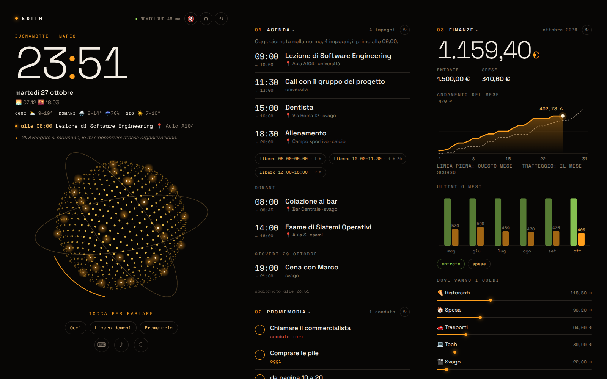
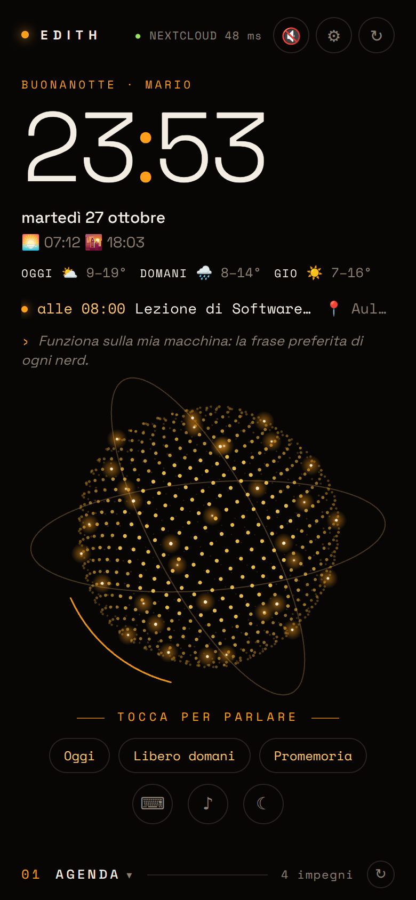
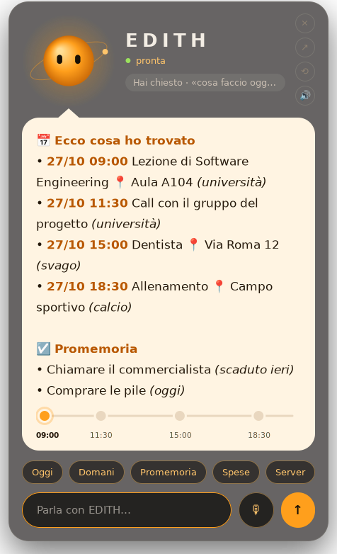
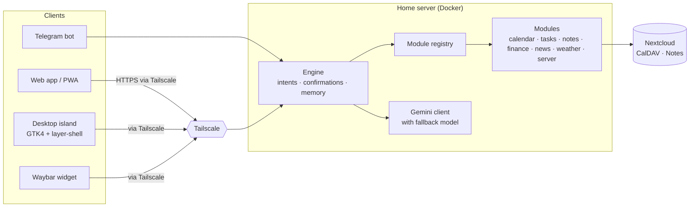

# EDITH — a self-hosted, modular personal assistant

[](https://github.com/Aleprantil/edith/actions/workflows/tests.yml)


EDITH is a personal assistant that runs **on your own home server**. You talk to it in natural language — by text or by voice — from Telegram, from a web app on your phone, or from your Linux desktop, and it manages your calendar, to-dos,
notes, expenses, news and server health. Your data stays at home: calendar, tasks and notes live in **your Nextcloud**, the web app is reachable only through **your Tailscale network**, and nothing is exposed to the internet.

> The user interface is in **Italian**. The code is commented in Italian too. New version in english is coming.

| Web app (desktop)                                       | Web app (phone)                                      | Desktop island (Hyprland)                      |
| ------------------------------------------------------- | ---------------------------------------------------- | ---------------------------------------------- |
|  |  |  |


## What it can do

- **One brain, many faces.** A single engine understands requests (via Google Gemini) and acts on them; Telegram, the web app and the desktop island are just different ways to talk to it, with the same confirmations and memory.
- **Natural language:** «cosa faccio domani?», «sposta il dentista a giovedì alle 10», «ho speso 12 euro di pizza», «promemoria entro le 18: chiamare Marco», «come sta il server?».
- **Safe actions:** anything destructive (delete, move) asks for confirmation with Yes/No buttons first.
- **Voice:** push-to-talk from the phone or the PC; on the desktop it answers back with a local voice (Piper), and the character's mouth follows the real audio.
- **Proactive messages on Telegram:** morning briefing, upcoming-event reminders, evening summary, server alerts, budget alerts, nightly charts saved to Nextcloud.
- **Memory:** «ricordati che il calcio è il martedì» — facts about you, stored in a Nextcloud note, used to understand you better.
- **Fully modular:** install the base, then switch on only the modules you want.

## Modules

The **base** (engine, Gemini, Telegram bot, web app, security) is always there. Modules are chosen in `.env`:

```env
EDITH_PLUGINS=calendar,tasks,notes,memory,weather,news,finance,server   # or "none" for the base only
```

| Module | What it does | Needs |
|---|---|---|
| `calendar` | agenda, create / move / delete events, free slots | Nextcloud |
| `tasks` | to-dos with due dates, tick them off | Nextcloud + the **Tasks** app |
| `notes` | write and read notes and lists | Nextcloud (the Notes app is optional, handy to read them) |
| `memory` | «ricordati che…» facts about you | Nextcloud |
| `weather` | 3-day forecast, sunrise and sunset | nothing (Open-Meteo, free) |
| `news` | daily headlines from your feeds, by folder, translated | Nextcloud + the **News** app with some feeds |
| `finance` | expenses, income, budgets, charts | nothing (SQLite); nightly charts go to Nextcloud if you have it |
| `server` | CPU, memory, disks, Nextcloud health and alerts | optional host probe |

A switched-off module disappears everywhere: from what Gemini is told it can do (so it can't be triggered by mistake),
from the web app cards, from the Telegram commands and from the automatic messages.

## Architecture



## Before you start

EDITH is **not a hosted service**: everyone runs their own. You need:

- **A small server** that stays on — a mini PC or a Raspberry Pi 4/5 with Linux and Docker. 4 GB of RAM is enough, 8 is better.
- **Nextcloud** (your own or an existing one) for the calendar, tasks, notes, memory and news modules, with the **Tasks** and **News** apps if you want those modules.
- **Tailscale** (free for personal use) to reach the web app from your phone and PC without opening any port, with **HTTPS certificates** enabled in the admin console.
- **A Gemini API key** (free tier available, from Google AI Studio) and **a Telegram bot** (from @BotFather).
- *Optional:* a Linux desktop with **Hyprland** for the island and the Waybar widget.

## Quick start

The full step-by-step guide, from an empty server to a working assistant, is in **[docs/SETUP.md](docs/SETUP.md)**. In short:

```bash
git clone https://github.com/Aleprantil/edith.git && cd edith
python3 edith-setup                      # asks a few questions, checks every connection, writes .env
docker compose up -d --build
tailscale serve --bg --https=8443 http://127.0.0.1:8787
```

Then open `https://<your-server>.<your-tailnet>.ts.net:8443` from any device on your tailnet, and say «ciao» to your bot on Telegram.

`edith-setup` only asks what is actually needed, and only for the modules you pick. It verifies the Telegram token,
finds your chat ID by itself, tests the Gemini key, lists your Nextcloud calendars and task lists, and geocodes your city
for the weather. Secrets are typed hidden and written only to `.env` (mode 600). Run it again any time to change
something; `python3 edith-setup --check` re-tests an existing configuration. Every setting is also documented in
[`.env.example`](.env.example).

The container runs as user `1000`: if your user on the server has a different UID, make sure the project folder is writable.

## Desktop (Hyprland)

- **Waybar widget** — a compact pill next to the clock: status dot, countdown to the next event, overdue to-dos.
- **The island** — drops down from the bar on click or `Super+E`: EDITH as an animated character that answers in a speech bubble,
  with push-to-talk and a local voice.

See [`desktop/README.md`](desktop/README.md) and [`desktop/island/README.md`](desktop/island/README.md).

## Security by design

- **No open ports.** The web app listens only on `127.0.0.1`; Tailscale exposes it to your devices, and only the accounts in
  `WEB_ALLOWED_LOGINS` get in. The Tailscale identity header is trusted only when the app listens locally.
- **Confirmations** for every destructive action, with single-use tokens bound to the session.
- **Untrusted input stays data:** user text and fetched headlines are passed to Gemini as data, and every answer is HTML-sanitized before it reaches a page.
- **Least privilege:** Telegram users allowed only for finance never see the calendar or the memory; the container runs as a non-root user.
- **Secrets only in `.env`**, never in code or logs; API keys travel in headers, not URLs.
- **Resilience:** if the main Gemini model is overloaded, requests fall back to a second model automatically.

## Development

```bash
pip install -r requirements.txt -r requirements-dev.txt
pytest -q                                 # 500+ tests, no network needed
python -m web.demo                        # the web app with fake data on http://127.0.0.1:8788
```

```
bot/        Telegram bot, scheduled messages
services/   engine, module registry, Gemini, Nextcloud, tasks, notes, memory, news, weather, monitor
finance/    finance module (SQLite, charts)
web/        web app (Starlette) and static PWA
desktop/    Waybar widget and Hyprland island (GTK4)
monitor/    optional host probe (systemd timer) for disk and SMART checks
tests/      the test suite
```

## How it was built

EDITH started as a personal project to run my own life from my own server. I designed it, chose the architecture and features, and I use and test it every day. I wrote the initial version myself and later developed improvements in collaboration with an AI pair programmer (Claude), carefully directing, reviewing, and testing every change. I'm always happy to discuss any design decisions and their trade-offs.
## License

[MIT](LICENSE)
